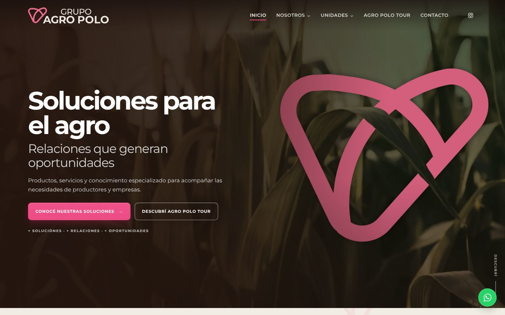
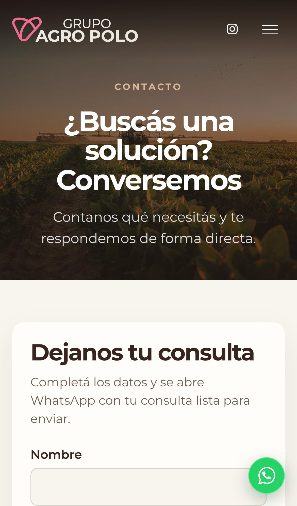

# Grupo Agro Polo · Sitio institucional

[](https://github.com/Marigi84/grupo-agro-polo-web/actions/workflows/ci.yml)

Sitio institucional de Grupo Agro Polo, una empresa de soluciones para el agro: presenta la compañía, sus cinco unidades de negocio, el Agro Polo Tour y los canales de contacto.

**En producción:** https://grupoagropolo.com

| | |
|---|---|
| **Stack** | React 19 · TypeScript · Vite 8 · React Router 7 |
| **Calidad** | Vitest + Testing Library (37 pruebas) · Oxlint · `tsc` en modo build · GitHub Actions · Dependabot |
| **Hosting** | Cloudflare Pages, con despliegue de vista previa por pull request |
| **Documentación** | [Requisitos](docs/requisitos.md) · [Decisiones de arquitectura (ADR)](docs/adr/README.md) |



| Inicio en el celular | Contacto en el celular |
|---|---|
|  |  |

## Mi rol

Proyecto real para una clienta, de septiembre a noviembre de 2026. Me encargué del proyecto de punta a punta:

- **Requisitos:** relevé lo que necesitaba la empresa a partir del material de Marketing (brochure, buyer personas, manual de identidad) y armé un [documento de requisitos](docs/requisitos.md) con prioridades MoSCoW y criterios de aceptación.
- **Diseño e implementación:** las ocho páginas, responsive y pensadas primero para el celular, con accesibilidad 100 en Lighthouse en casi todas.
- **Gestión del trabajo:** una rama y un pull request por cambio, cada uno con su vista previa, que Marketing revisaba antes de integrarlo. Coordiné rondas de corrección con Marketing.
- **Calidad y DevOps:** pruebas automatizadas, CI en GitHub Actions, Dependabot y encabezados de seguridad.
- **Puesta en producción:** mudanza de Vercel a Cloudflare Pages, DNS del dominio sin afectar el correo de la empresa, sitemap y Search Console. Publiqué la versión 1.0.0.

Para el trabajo usé asistentes de IA como herramienta, siempre con revisión y aprobación mía antes de cada merge.

> Este repositorio es la copia pública del código de la versión 1.0.0. El desarrollo se hizo en un repositorio privado, con más de 50 pull requests revisados y mergeados uno por uno. El historial quedó privado porque incluía datos de contacto de personas de la empresa.

---

## Índice

1. [Contexto y audiencia](#contexto-y-audiencia)
2. [Mapa del sitio](#mapa-del-sitio)
3. [Puesta en marcha](#puesta-en-marcha)
4. [Arquitectura](#arquitectura)
5. [Decisiones de diseño y producto](#decisiones-de-diseño-y-producto)
6. [Gestión de contenidos](#gestión-de-contenidos)
7. [Flujo de trabajo](#flujo-de-trabajo)
8. [Alcance](#alcance)

---

## Contexto y audiencia

El sitio se dirige principalmente a productores agropecuarios de 40 a 60 años, cuya decisión de compra se apoya en la confianza y la recomendación. Esto condiciona todo el diseño:

- **Contacto directo visible**, con WhatsApp como canal principal.
- **Legibilidad en el celular**: tipografía grande, textos breves y jerarquía clara.
- **Tono cercano y concreto**, sin tecnicismos innecesarios ni promesas de resultados.

La excepción es **+CLEAN**, orientada a frigoríficos y plantas agroindustriales, que adopta un registro más técnico.

## Mapa del sitio

| Ruta | Página | Contenido principal |
|---|---|---|
| `/` | Inicio | Propuesta de valor, "El diferencial está en el vínculo", unidades de negocio, alianzas y Agro Polo Tour |
| `/labs` | +LABS | Nutrición y aplicación con asesoramiento técnico. Explorador de soluciones: Aplicación, Nutrición y Agua |
| `/protect` | +PROTECT | Seguros por actividad. Coberturas y acompañamiento desde la cotización hasta la vigencia |
| `/clean` | +CLEAN | Limpieza y desinfección para frigoríficos y plantas agroindustriales |
| `/events` | +EVENTS | Diseño y producción de eventos. Objetivos del evento y vínculo con el Tour |
| `/farms` | +FARMS | Compra y venta de campos. Criterios de evaluación y proceso de acompañamiento |
| `/agro-polo-tour` | Agro Polo Tour | Historia del Tour (Nace / Crece / Continúa) y galería |
| `/contacto` | Contacto | Teléfono, WhatsApp, correo, Instagram y formulario que abre WhatsApp con la consulta armada |
| `*` | 404 | Página no encontrada |

Todas las páginas comparten un layout común con header, navegación con submenús (Nosotros y Unidades), footer y acceso flotante a WhatsApp.

## Puesta en marcha

### Requisitos

- Node.js 20.19 o 22.12 en adelante
- npm 10 o superior

### Instalación y desarrollo local

```bash
npm install
npm run dev
```

### Scripts

| Script | Descripción |
|---|---|
| `npm run dev` | Servidor de desarrollo con recarga en caliente |
| `npm run typecheck` | Verificación de tipos con `tsc -b` |
| `npm run lint` | Análisis estático con Oxlint |
| `npm test` | Suite de pruebas con Vitest |
| `npm run build` | Verificación de tipos y build de producción en `dist/` |
| `npm run preview` | Sirve localmente el build de producción |

## Arquitectura

```text
src/
├── app/               # Definición de rutas (AppRouter)
├── components/
│   ├── layout/        # SiteLayout: header, navegación, footer y WhatsApp
│   └── SolutionExplorer.tsx
├── data/              # Navegación y datos de las unidades de negocio
├── pages/             # Una página por ruta
├── styles/            # Estilos globales y variables de diseño
└── test/              # Configuración de Vitest
public/images/         # Fotografías (WebP) y logotipos (SVG)
docs/                  # Requisitos, decisiones de arquitectura (adr/) y capturas
```

**Criterios técnicos**

- **SPA con React Router.** El build genera un HTML por ruta (`labs.html`, `protect.html`…) que Cloudflare Pages sirve en `/labs`, `/protect`…, y un `404.html` que devuelve estado 404 para direcciones inexistentes. Los encabezados de seguridad están en `public/_headers`. Ver [ADR 0001](docs/adr/0001-spa-con-html-por-ruta.md) y [ADR 0002](docs/adr/0002-hosting-en-cloudflare-pages.md).
- **Componentes compartidos antes que duplicación.** Las secciones de opciones de +LABS, +PROTECT, +EVENTS y +FARMS usan un único componente, `SolutionExplorer`, con presentación en formato lista.
- **Header adaptativo.** `SiteLayout` define por ruta si la barra arranca transparente sobre el hero y si usa la variante clara u oscura del logo.
- **Imágenes optimizadas.** Fotografías en WebP y logotipos en SVG vectorial, extraídos de los originales de Marketing.
- **Accesibilidad.** HTML semántico, desplegables con `aria-expanded` y `aria-controls`, y animaciones que respetan `prefers-reduced-motion`.

## Decisiones de diseño y producto

| Decisión | Motivo |
|---|---|
| Cada página se implementa a partir de un prototipo o referencia visual aprobada, y se respeta tal cual | Garantiza coherencia con la identidad de marca y evita reinterpretaciones |
| Las fotografías principales y los logotipos de cada unidad son los provistos por Marketing | Unifica la comunicación visual en todos los canales |
| Fotografías y logotipos se muestran completos, sin recortes | Pedido explícito de Marketing; la proporción de cada pieza define su contenedor |
| Sin líneas fucsias sobre fotografías o secciones, sin fondos beige rosados y con uso medido del rosa | Resultado de la revisión de Marketing de octubre de 2026 |
| Se descartaron el isotipo animado, el isotipo 3D con scroll y el semicírculo en Alianzas | Rechazados por Marketing por distraer del mensaje |
| Slogan "Ser cliente suma+ / Ser parte suma+", en dos líneas | Validado por Marketing; reemplaza alternativas evaluadas |
| Títulos y slogans sin punto final | Criterio editorial de la marca |

## Gestión de contenidos

- Marketing es la fuente de verdad de textos, fotografías, logotipos y datos. El material de base (brochure comentado, buyer personas, manual de identidad y estrategia de comunicación) se encuentra en la carpeta de Marketing en Google Drive.
- **No se publican datos sin confirmar.** Cifras, nombres de aliados y contactos pendientes de validación se marcan como tales y no se completan con supuestos.
- Ante un cambio de cifra solicitado por Marketing, se modifica solo el dato, sin reescribir el texto que lo contiene.
- Ninguna imagen se elimina hasta contar con su reemplazo definitivo.

## Flujo de trabajo

1. **Una rama por cambio.** No se trabaja directamente sobre `main`.
2. **Controles locales obligatorios** antes de abrir el pull request:

   ```bash
   npm run typecheck && npm run lint && npm test && npm run build
   ```

3. **Integración continua.** El workflow `.github/workflows/ci.yml` repite esos mismos controles en GitHub Actions en cada PR y en cada push a `main`, sin importar quién sea el autor. Un PR con el check de CI en rojo no se mergea.
4. **Pull request con vista previa.** Cloudflare Pages genera un despliegue de vista previa por PR (en `*.pages.dev`, sin indexar en buscadores), accesible sin autenticación para que Marketing pueda revisarlo.
5. **Revisión en dispositivo real.** Cada cambio se valida en la vista previa, con prioridad en el celular.
6. **Merge con aprobación explícita** de la responsable del proyecto para ese PR en particular.

Las tareas se gestionan con GitHub Issues y el tablero **Sitio web Grupo Agro Polo**. Los errores se reportan con la plantilla de `.github/ISSUE_TEMPLATE`.

## Alcance

**Incluido en la primera versión:** inicio institucional, páginas de las cinco unidades, Agro Polo Tour, información institucional y alianzas, contacto con formulario y WhatsApp, descargables provistos por Marketing, SEO y analítica básicos, diseño responsive y animaciones sutiles.

**Fuera de alcance:** precios, e-commerce, cotizador, CMS, blog, buscador, CRM y versiones en otros idiomas. Cualquier ampliación se evalúa por separado.

## Licencia

El código fuente se publica bajo licencia [MIT](LICENSE). Las fotografías, los logotipos, los catálogos y los textos son propiedad de Grupo Agro Polo y de sus aliados, y no están incluidos en esa licencia.

---

**Autora:** Marina Giselle Cordero
